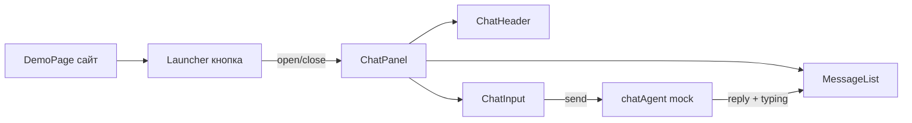
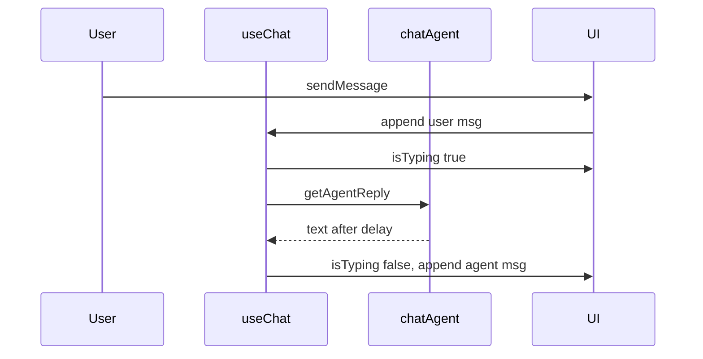

# Frontend чата ИИ-агента в стиле Jivo

## Контекст

Репозиторий `[D:\work\Students\wed1500\11\ai-chat](D:\work\Students\wed1500\11\ai-chat)` сейчас пустой (кроме правила про моки в `[.cursor/rules/mock-data.mdc](.cursor/rules/mock-data.mdc)`). Реализация — **с нуля**.

Выбрано: **Vite + React (JS)**, **виджет + демо-страница**, **светлая/тёмная тема с переключателем**, **ответы агента через моки**.

## Референс UX (Jivo)




- Круглая **кнопка-лаунчер** справа снизу, смена иконки при открытии.
- **Панель** над кнопкой (~380×520px на desktop), скругления, тень, анимация появления.
- **Шапка**: аватар, имя агента, статус «В сети», кнопки свернуть/закрыть, переключатель темы.
- **Лента сообщений**: пузыри пользователя справа, агента слева; автоскролл вниз; приветствие при первом открытии.
- **Быстрые ответы** (chips) под приветствием — по клику отправляют текст как сообщение пользователя.
- **Поле ввода**: многострочное, Enter — отправка, Shift+Enter — новая строка; кнопка «Отправить».
- **Typing indicator** на время «думает» агент (мок с `setTimeout`).

## Структура проекта

```
ai-chat/
  package.json
  vite.config.js
  index.html
  public/avatars/agent.svg
  src/
    main.jsx
    App.jsx
    styles/
      tokens.css          # CSS-переменные light/dark
      global.css
    components/
      DemoPage/
        DemoPage.jsx
        DemoPage.module.css
      ChatWidget/
        ChatWidget.jsx
        LauncherButton.jsx
        ChatPanel.jsx
        ChatHeader.jsx
        MessageList.jsx
        MessageBubble.jsx
        ChatInput.jsx
        TypingIndicator.jsx
        QuickReplies.jsx
        chatWidget.module.css   # общие стили виджета
    hooks/
      useChat.js
      useTheme.js
    services/
      chatAgent.js              # единая точка: сейчас только mock
    mocks/
      agentProfile.mock.js
      quickReplies.mock.js
      agentReplies.mock.js      # сценарии ответов по ключевым словам + fallback
```

## Ключевая логика

### `useTheme.js`

- Состояние `light` | `dark`, сохранение в `localStorage` (`ai-chat-theme`).
- Атрибут `data-theme` на корне виджета (и при желании на `document.documentElement` для демо-фона).
- Переключатель в шапке чата.

### `useChat.js`

- Состояние: `isOpen`, `messages[]`, `isTyping`, `hasGreeted`.
- При первом открытии — системное приветственное сообщение из `[mocks/agentProfile.mock.js](src/mocks/agentProfile.mock.js)`.
- `sendMessage(text)` → добавить user bubble → `isTyping = true` → вызов `getAgentReply(text)` из `[services/chatAgent.js](src/services/chatAgent.js)` → typing off → agent bubble.
- Генерация `id` через `crypto.randomUUID()` или счётчик.

### `services/chatAgent.js` + моки

- `USE_MOCK = true` (позже: `import.meta.env.VITE_USE_MOCK`).
- Задержка ответа 600–1500 ms (случайная), чтобы имитировать сеть.
- `[agentReplies.mock.js](src/mocks/agentReplies.mock.js)`: 5+ сценариев (приветствие, цена, поддержка, неизвестный запрос) + универсальный fallback на русском.
- `[quickReplies.mock.js](src/mocks/quickReplies.mock.js)`: 4–5 chips («Как это работает?», «Связаться с оператором» и т.д.).

Пример контракта сообщения:

```javascript
{ id, role: 'user' | 'agent' | 'system', text, createdAt: ISO string }
```

### `DemoPage`

- Простой лендинг (hero, блоки «услуги») на русском — чтобы виджет выглядел как на реальном сайте.
- Виджет монтируется в `App.jsx` поверх страницы (`position: fixed` внутри виджета).

## Стили и адаптив

- **CSS Modules** для компонентов + `[tokens.css](src/styles/tokens.css)` с переменными (`--chat-bg`, `--bubble-user`, `--bubble-agent`, `--accent`, радиусы, тени).
- Desktop: панель справа снизу; **mobile** (`max-width: 480px`): панель на весь экран с отступом сверху, лаунчер остаётся доступным.
- `prefers-reduced-motion`: отключить/упростить анимации открытия.
- Доступность: `aria-expanded` на лаунчере, `aria-label` на кнопках, фокус в поле ввода при открытии.

## Зависимости

- `vite`, `react`, `react-dom` — без тяжёлых UI-библиотек (KISS).
- Опционально: `clsx` не добавляем — условные классы через template strings.

## Проверка после реализации

1. `npm install` → `npm run dev`.
2. Демо-страница загружается, виджет закрыт по умолчанию.
3. Открытие/закрытие, приветствие, quick replies, отправка текста, typing, ответ мока.
4. Переключение темы сохраняется после перезагрузки.
5. Узкий viewport — панель не обрезается, скролл ленты работает.

## Что сознательно не входит в v1

- Реальный WebSocket/API, вложения, звук, оценка диалога, история в backend.
- Отдельный npm-пакет для встраивания на чужие сайты (можно добавить позже как `embed.js`).




